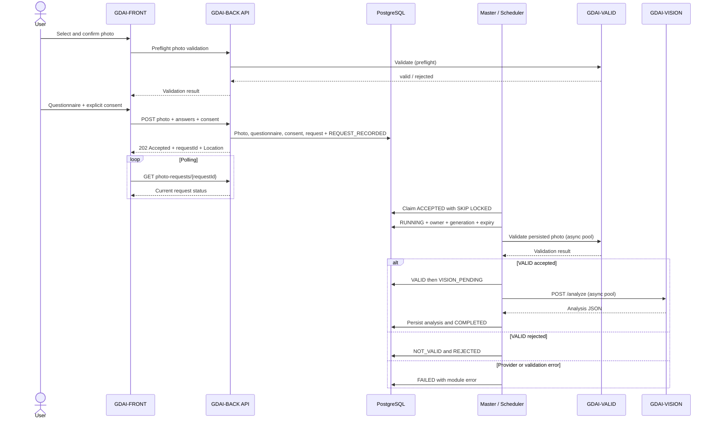

# GDAI photo processing — merged workflow (PR #35)

Source of truth: [PR #35](https://github.com/boonsuli/GardnAIze/pull/35), merged on 2026-11-13. This document describes the implemented **VALID → VISION** request workflow, not the complete PLANT recommendation E2E.

## Sequence

## API and ownership

- GDAI-FRONT talks **only** to GDAI-BACK, never directly to VALID, VISION or Gemini.
- `POST /api/v1/gardens/{gardenId}/photos`: multipart `file`, optional `description`, `answersJson`, `consentKey=privacy.externalProcessingNotice`. The server checks explicit consent and required answers (`exposure`, `waterAvailability`, `maintenancePreference`). HTTP **202** confirms persistence and queue acceptance, **not** final processing.
- `GET /api/v1/gardens/{gardenId}/photo-requests/{requestId}`: persisted request status. Angular polls after 2 seconds and then every 3 seconds, up to 100 checks; it stops on `COMPLETED`, `FAILED`, `REJECTED` or `RECONCILIATION_REQUIRED`.
- The browser's preflight validation and the worker's validation of the persisted image are distinct calls. Do not infer that preflight replaces the worker validation.

## State machines and transition conditions

### Request: `garden_photo_requests.status`

| From | To | Condition / trigger | Event |
| --- | --- | --- | --- |
| — | `ACCEPTED` | Photo, questionnaire, consent and request committed in one transaction | `REQUEST_RECORDED` |
| `ACCEPTED` | `RUNNING` | Master claims row with `FOR UPDATE SKIP LOCKED`; sets owner, expiry, increments attempt and generation | `WORKER_CLAIMED` |
| `RUNNING` | `COMPLETED` | VALID accepts and VISION returns analyzable garden JSON | `WORKFLOW_COMPLETED` |
| `RUNNING` | `REJECTED` | VALID rejects or VISION says garden not analyzable | `WORKFLOW_REJECTED` |
| `RUNNING` | `FAILED` | Technical exception or dispatch failure, subject to lease fencing | `WORKFLOW_FAILED` / `WORKER_DISPATCH_FAILED` |
| `RUNNING` | `RECONCILIATION_REQUIRED` | Lease expires; no automatic replay of potentially billable VISION call | `LEASE_EXPIRED` |

`COMPLETED`, `FAILED`, `REJECTED` are terminal in the current dispatcher. `RECONCILIATION_REQUIRED` is an operational hold (terminal for FRONT polling), **not** a successful recovery. No automatic `RECONCILIATION_REQUIRED → RUNNING` path is implemented.

### Photo: `garden_photos.workflow_status`

| State | Entry condition | Next possible state |
| --- | --- | --- |
| `DRAFT` | New persisted photo (default) | `VALIDATING` |
| `VALIDATING` | Worker starts VALID | `VALID`, `NOT_VALID`, `VALIDATION_FAILED` |
| `VALID` | VALID returns `valid=true` with required response fields | `VISION_PENDING` |
| `NOT_VALID` | VALID rejects or VISION rejects analyzability | No downstream VISION when VALID rejects |
| `VALIDATION_FAILED` | VALID HTTP, response-contract or execution failure | No automatic replay |
| `VISION_PENDING` | Positive VALID completed; VISION queued | `VISION_PROCESSING` |
| `VISION_PROCESSING` | VISION module starts | `VISION_COMPLETED`, `NOT_VALID`, `VISION_FAILED` |
| `VISION_COMPLETED` | VISION returns `isGarden=true`, `isAnalyzable=true`, object `description` | End of current VALID/VISION workflow |
| `VISION_FAILED` | VISION technical failure | No automatic replay |

The canonical photo status is separate from request status. Legacy `photo_status` and `processing_status` still exist for compatibility and are **not** synonyms of `workflow_status`. Some error/reconciliation paths may leave a photo at its last successfully committed state; inspect request and module history together.

### Module execution: `garden_photo_module_runs.status`

Allowed textual values: `PENDING`, `RUNNING`, `COMPLETED`, `FAILED`, `SKIPPED`, `REJECTED`. Currently, `VALID` and `VISION` create `RUNNING` records and finish as `COMPLETED`, `FAILED`, or `REJECTED`. `PENDING` and `SKIPPED` are schema-supported but not part of the normal active worker path. The module-name constraint also permits `SEGMENTATION` and `PLANT`, **not yet executed by this workflow**. A module run tracks UUID, request UUID, attempt, start/end timestamps and error code.

## Leases, heartbeat, fencing and crash handling

- Master polls approximately every **5 s**, claims one `ACCEPTED` request and assigns `lease_owner`, `lease_until=now()+180 s`, increments `attempt_count` and `lease_generation`.
- Heartbeat runs approximately every **30 s** and renews an active future's lease by **180 s** only when owner, generation, `RUNNING` status and non-expiration still match.
- Worker receives the immutable tuple `(requestId, lease_owner, lease_generation)`. `PhotoWorkflowFencingService` locks the request row `FOR UPDATE` and checks owner, generation, status and expiry before photo/module/request mutations or VISION JSON persistence. The mutation and its history are in the **same PostgreSQL transaction**.
- Expired `RUNNING` requests are moved to `RECONCILIATION_REQUIRED` with generation increment and ownership cleared. `PhotoLeaseReconciliationService` commits this update and `LEASE_EXPIRED` audit event **atomically** using `TransactionTemplate`; injected failure causes rollback of both.
- A stale worker must not write after lease expiry or generation change. `LeaseLostException` prevents the stale completion. A timeout/remote-call ambiguity is **quarantined**, not automatically retried, to avoid duplicate Gemini billing.
- This is **crash detection and safe isolation**, not fully automatic replay/recovery of interrupted VISION requests.

## Events and observability

Request audit: `REQUEST_RECORDED`, `WORKER_CLAIMED`, `WORKFLOW_COMPLETED`, `WORKFLOW_FAILED`, `WORKFLOW_REJECTED`, `WORKER_DISPATCH_FAILED`, `LEASE_EXPIRED`. Module audit: `VALID_STARTED`, `VALID_COMPLETED`, `VALID_FAILED`, `VALID_REJECTED`, `VISION_STARTED`, `VISION_COMPLETED`, `VISION_FAILED`, `VISION_REJECTED`. Photo audit: `VALIDATION_STARTED`, `VALIDATION_COMPLETED`, `VALIDATION_REJECTED`, `VALIDATION_FAILED`, `VISION_QUEUED`, `VISION_STARTED`, `VISION_COMPLETED`, `VISION_REJECTED`, `WORKFLOW_FAILED`. Operational logs additionally include `LEASE_LOST`, `STALE_WORKER_DISCARDED` and `WORKFLOW_STATE_WRITE_FAILED`; not every log event is a persisted history event.

Logs use SLF4J/Logback and MDC `requestId` on worker threads; log event codes, IDs and error categories, **never** image bytes/base64, consent text, questionnaire answers or API credentials.

## Database and tests

- Flyway V12: canonical photo workflow and photo history.
- V13: questionnaire and consent.
- V14: request and request history.
- V15: leases, module runs and enriched request history.
- V16: lease generation and reconciliation state.
- `PhotoWorkflowWorkerIT`: local HTTP stubs for VALID/VISION (no Gemini spend), accepted/rejected/provider failure.
- `PhotoWorkflowMasterIT`: claim-once, heartbeat, crash/restart quarantine and injected rollback atomicity.
- `PhotoWorkflowFencingIT`: stale worker cannot persist photo, module, VISION JSON or request terminal state.

## Follow-up PRs / boundaries

1. GDAI-VALID segmentation, then independent **parallel** VISION and segmentation branches with an explicit join policy in GDAI-BACK.
2. GDAI-PLANT Random Forest and normalized horticultural recommendation persistence.
3. Optional GDAI-GNERAT image editing; must not block recommendations or change the original photo.
4. Operational policy for manually reviewed `RECONCILIATION_REQUIRED` requests; provider-side idempotency or reconciliation before any paid replay.
5. End-to-end verification of actual VALID and VISION API schemas, provider behavior and final plant recommendation UX. Passing mocked integration tests does not establish real-provider compatibility.
